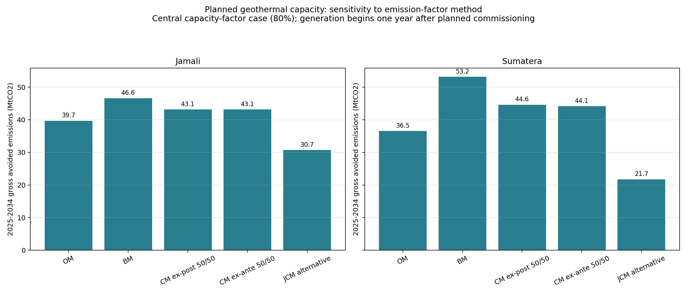
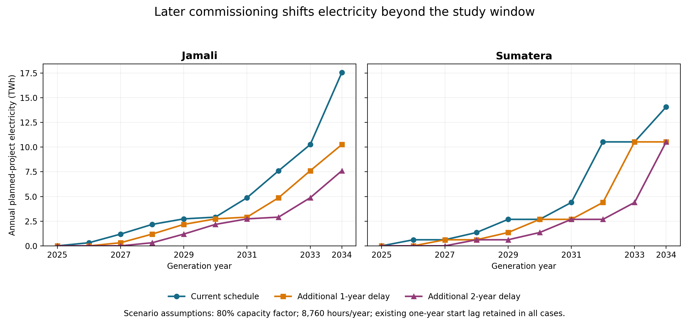
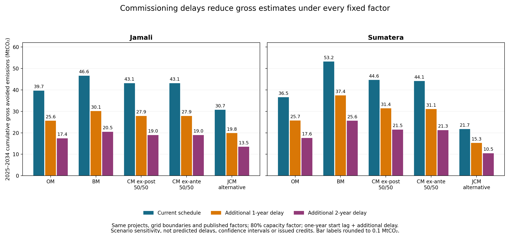
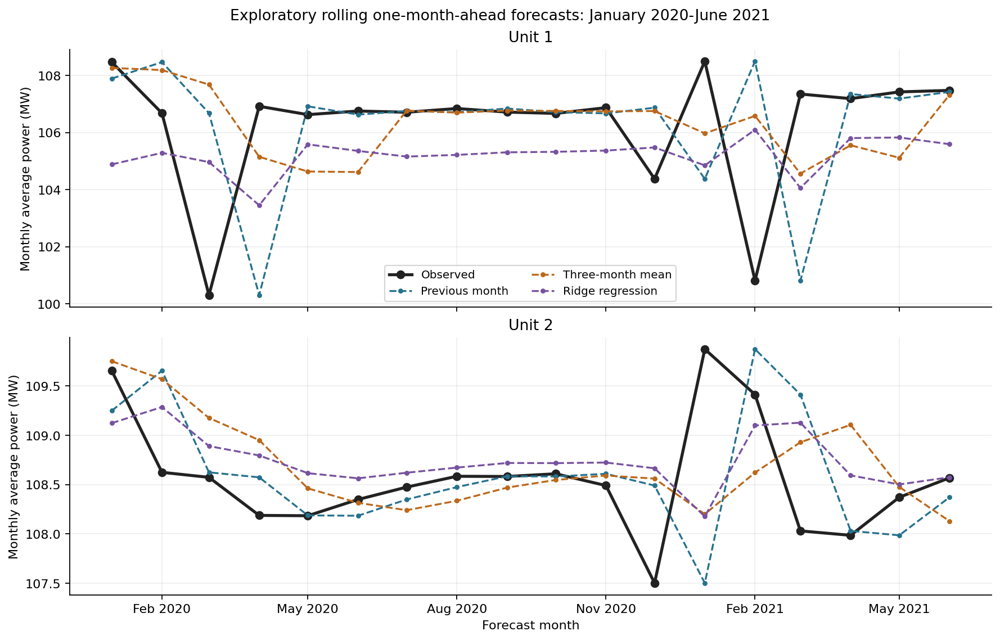
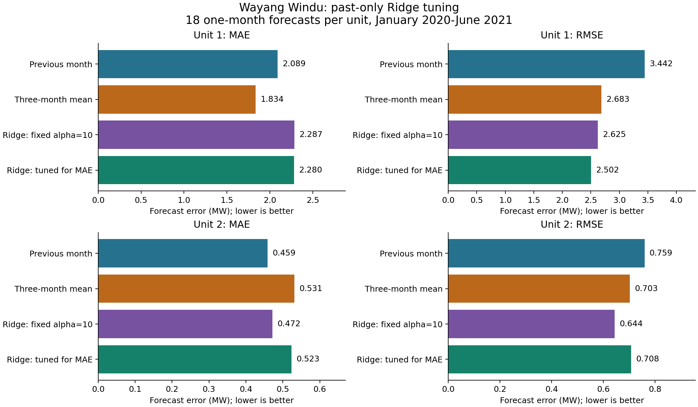

# Geothermal Avoided Emissions in Jamali and Sumatera, 2025–2034

> **Previous research direction, preserved as background.** As of 6 November 2026, the active project concerns methods and data readiness for short-run marginal emission factors in Jamali. See the [current mission](mef_research/MISSION.md) and [new report](mef_research/REPORT.md). Questions and proposed next steps below describe the earlier study; its proposed CM-weight experiment is deferred. Existing results are unchanged and are not MEF estimates.

## Research focus

### Main research question

**How does the choice of grid emission-factor method affect estimated gross avoided emissions from planned geothermal projects in Jamali and Sumatera from 2025 to 2034?**

### Supporting question

**How sensitive are those estimates to assumptions about geothermal generation, commissioning timing and the electricity generation displaced, and what additional evidence would make the estimates better supported?**

The main question is retained because it can be answered with the data already assembled. The supporting question extends the work from comparing published factors to investigating the assumptions behind the estimates. The objective is not to train a model that declares one emission factor universally correct. It is to explain why estimates differ, test clearly stated alternatives and identify which assumptions need better evidence.

The project contains an AI/ML component, but its role is limited to an observable prediction task: historical geothermal plant output. Its performance is evaluated against simple forecasting methods. This component is not presented as a validated method for selecting a grid emission factor or forecasting all planned geothermal projects through 2034.

### Policy extension

**Do applicable Indonesian rules and technical guidance adequately specify the selection, justification, disclosure and review of CM factors for geothermal, or are targeted improvements warranted?** This extension does not replace the main question or presume that a law must change. A targeted documentary review, completed on 6 November 2026, is summarised in Section 9.1.

## 1. Why this is a feasible research direction

Gross avoided emissions depend on both the quantity of geothermal electricity supplied and the emissions associated with the electricity it is assumed to replace:

**Gross avoided emissions = geothermal electricity × displaced-grid emission factor.**

Different published factors represent different baseline approaches. Their numerical differences change the estimate even when geothermal electricity is held constant. Generation assumptions, project timing and the replacement-generation assumption introduce further variation.

These are related but different research tasks:

| Task | What can be assessed | What cannot be concluded from that task alone |
|---|---|---|
| Published-factor sensitivity | How the estimate changes when the factor changes | Which method is physically most accurate or required for a particular crediting project |
| Generation and timing sensitivity | How assumed operating performance and commissioning affect generation and emissions | Actual future project performance |
| Replacement-generation scenarios | How explicit coal, gas or mixed replacement rules affect the result | Which generators would actually respond without a dispatch/capacity model |
| Historical plant-output ML | Forecast errors against observed monthly output | The counterfactual grid response, a national capacity factor or future credits |

An estimate that is more transparent and better supported is not automatically proven more accurate. Accuracy requires a suitable reference. Historical plant output is observed and can be used to measure forecast error. The future electricity system without the planned geothermal projects is a counterfactual: it is not observed alongside the future system with those projects.

## 2. Study boundaries

The main analysis covers planned geothermal additions assigned to the Jamali and main Sumatera grids during 2025–2034. Existing geothermal capacity is not counted as a new project in this calculation.

The site-checked mapping assigns 2,503 MW of planned additions to Jamali and 2,007 MW to the main Sumatera grid. An additional 10 MW belongs to the separate Sabang system. PLN's wider Sumatera planning region includes 2,017 MW, so that planning-region total should not be substituted into the main-grid calculation without checking the boundary. The two site-checked study grids cover approximately 94.6% of installed capacity and 87.5% of planned additions in the GENESIS snapshot.

These grids were selected because they contain most of the mapped geothermal capacity and have relevant published grid factors. A larger regional total does not make source errors or outliers unimportant.

The results are **gross avoided grid emissions**, before subtracting project emissions or assessing additionality, monitoring, verification and crediting eligibility. They are not issued carbon credits.

## 3. Data sources and their roles

Government publications, international organisation indicators and independent data providers are distinguished rather than grouped together as official Indonesian sources.

| Dataset or source | Coverage inspected | Role in this research | Important limitation |
|---|---|---|---|
| ESDM EBTKE GENESIS | 71 sites; 133 planned-unit records; 2025–2034 outlook | Project capacity, location, status and planned commissioning | A planning/current-status snapshot, not historical generation or guaranteed completion |
| ESDM grid emission-factor decree, based on 2019 data | 154 grid entries; OM, BM and CM where available | Main published-factor comparison | Historical inputs; factors are not a changing-grid forecast through 2034 |
| JCM Indonesia grid-factor note | Alternative factors based on 2016–2018 information | Separate programme-specific baseline comparison | Different methodology and vintage; not interchangeable with CDM-style margins |
| PLN RUPTL 2025–2034 | Historical tables and RE Base/ARED projections | Grid context, future fuel mix and explicit replacement scenarios | A plan, not observed future dispatch; both scenarios already include geothermal |
| Ember Energy API | Inspected Indonesian annual data, 2000–2025 | National electricity-mix context and earlier demand experiment | No Indonesian monthly records in the inspected extracts; lifecycle national averages are not official marginal factors |
| World Bank indicators | Indonesian consumption per person, 1990–2024, plus selected macro indicators | Earlier exploratory forecasting work, retained in Appendix B | National annual consumption is not geothermal generation or regional dispatch |
| UNFCCC CDM project 3193 monitoring report, revised version 04 | Wayang Windu Units 1 and 2, January 2018–June 2021 | Historical plant-output EDA and ML case study | One field, 42 distinct months; Main Meter quantity is not automatically eligible net grid delivery |
| New Zealand Electricity Authority EMI | Downloaded monthly files for 2015–2025, containing geothermal interval records | Potential later multi-plant comparison | Not used in the Indonesian forecast experiments; transfer has not been demonstrated |

ESDM MIGAS and Our World in Data were considered as potential background sources. They are not necessary inputs to the completed main sensitivity calculation and should not be described as evidence of which generators geothermal displaces.

### Data preparation and quality checks

**GENESIS.** Publicly accessible records were used, without accessing company-only information. Capacities and coordinates were converted to numeric fields; missing values were not filled. The implausible longitude for Koto Sani Tanjung Bingkung was flagged and excluded from the map rather than silently corrected. Rantau Dedap's reported capacity/status inconsistency was retained and flagged. Planned-unit totals were checked against site totals. The snapshot contains planned units in 2025–2033; a 2034 outlook row does not imply additional units were observed for that year.

**Grid factors.** Missing factors remained missing. Transcription corrections were documented, including decimal-printing errors. Grid boundaries were checked against site locations rather than assuming that every project on Sumatera island belongs to the main Sumatera grid. The model uses the factors recorded in its source table; it does not fill missing values using national intensity.

**RUPTL.** Fuel subtotal rows were excluded when adding generation to avoid double counting. Historical 2024 generation is flagged as partial/unaudited to October and is not treated as a complete actual year. Historical sales have their own source status, including a 2024 forecast designation. Historical Sumatera generation is combined with Kalimantan, so it cannot establish Sumatera's historical complete fuel mix. Jamali's later projected geothermal generation includes imports from Sumatera and cannot be divided by local capacity to infer a local capacity factor. Captive industrial generation is outside the stated RUPTL supply coverage.

**Ember.** The inspected Indonesian annual generation and emissions extracts have 416 rows each and carbon intensity has 26 rows, covering 2000–2025. No Indonesian monthly records were found in the inspected monthly datasets. Fuel charts exclude aggregate series to avoid double counting. Net imports are excluded from domestic fuel-generation charts, but remain relevant to demand and cross-border accounting. The 2025 annual-demand estimate was excluded from the earlier forecast backtest. Dataset row counts describe the saved extraction, not guaranteed current API coverage.

**Wayang Windu.** The complete January 2018–June 2021 monthly Main Meter values were retained. Partial December 2017 and months outside coverage were excluded, not filled with zeros. All 84 unit-month values were checked against the revised source report in a same-analyst second pass; this was not independent second-person verification or reconciliation against a complete daily series. No gaps, duplicate months, missing values or negative/zero monthly totals were found. Published August–September 2018 meter adjustments were retained without applying them twice. Low-output months were not removed.

## 4. Understanding the emission-factor comparison

The operating margin, build margin and combined margin are baseline concepts, not three interchangeable measurements of exactly the same target. UNFCCC TOOL07 describes the operating margin in terms of existing generation affected by a project, and the build margin in terms of prospective construction and operation affected by it. The combined margin combines the two under specified rules. These definitions do not establish the actual displaced plants in this study.

- **Operating margin (OM):** a methodological estimate associated with affected existing generation. The applicable calculation is not necessarily the average of all existing generation.
- **Build margin (BM):** a methodological estimate related to prospective additions, calculated using a defined sample of recent units. It is not proof that a particular coal project will be cancelled.
- **Combined margin (CM):** a weighted combination of OM and BM. The model compares published 50/50 values; this is not evidence that any project may freely select that weighting.
- **JCM alternative:** a distinct programme-specific baseline approach, included as a separate comparison rather than treated as another OM/BM weighting.

The published factors used in the current model are:

| Grid | OM | BM | CM ex-post 50/50 | CM ex-ante 50/50 | JCM alternative |
|---|---:|---:|---:|---:|---:|
| Jamali | 0.800 | 0.940 | 0.870 | 0.870 | 0.619 |
| Sumatera | 0.770 | 1.120 | 0.940 | 0.930 | 0.458 |

All values are tCO₂/MWh. ESDM entries are based on 2019 information; the JCM alternative uses 2016–2018 information. Consequently, the comparison varies published baseline specifications, including methodological and data-vintage differences. It does not isolate a pure method effect with all underlying data held identical.

The ex-ante CM has a stated 2022–2030 coverage period. Applying it unchanged through 2034 in a sensitivity comparison does not establish applicability for 2031–2034. Ex-ante does not mean that every future year's physical marginal emissions have been forecast.

Ember's national lifecycle intensity and RUPTL's projected average combustion intensity have different boundaries from these factors. A numerical match to either would not prove that a margin factor is accurate. The applicable crediting methodology and programme rules would need separate assessment for an actual project.

## 5. Completed analysis: fixed-factor sensitivity

### Calculation

For each grid and analysis year, the model estimates electricity from the accumulated planned capacity that has reached its assumed generation start year:

**Estimated electricity (MWh) = operating planned capacity (MW) × 8,760 × assumed capacity factor.**

**Estimated gross avoided emissions (tCO₂) = estimated electricity (MWh) × selected published factor (tCO₂/MWh).**

The model assumes a one-year lag from the listed commissioning year to the first full generation year. It uses a fixed 8,760-hour modelling year, rather than calendar-specific leap-year hours. The central capacity factor is 80%; existing low and high cases are 70% and 90%. These assumptions are held constant across factor methods so the factor comparison is interpretable.

The published factors are held fixed over the capacity schedule. This is an illustrative 2025–2034 sensitivity calculation, not a forecast of actual future emission factors.

### Results at the central 80% capacity factor

| Grid | Estimated cumulative electricity | Lowest gross estimate: JCM alternative | Highest gross estimate: BM | Difference |
|---|---:|---:|---:|---:|
| Jamali | 49.59 TWh | 30.7 MtCO₂ | 46.6 MtCO₂ | 15.9 MtCO₂ |
| Main Sumatera grid | 47.47 TWh | 21.7 MtCO₂ | 53.2 MtCO₂ | 31.4 MtCO₂ |

The differences are calculated from unrounded model outputs, then rounded to one decimal place. Subtracting the displayed rounded Sumatera endpoints gives 31.5; the unrounded difference is 31.421951808 MtCO₂ and rounds to 31.4.

Changing the published factor materially changes gross avoided emissions while estimated geothermal electricity remains unchanged. The wider factor range in Sumatera produces a larger spread. BM is highest and the JCM alternative lowest among the compared specifications; neither the largest nor the smallest estimate is automatically the most accurate or the required crediting baseline.

### Generation sensitivity already available

At a fixed factor and commissioning schedule, avoided emissions scale directly with assumed capacity factor. Relative to the central 80% case, the 70% case reduces modelled electricity and gross avoided emissions by 12.5%, and the 90% case increases them by 12.5%.

These are scenario changes, not confidence intervals. Their width reflects chosen assumptions, not an estimated probability distribution. The wider spread from some factor choices does not establish that factor uncertainty is always more important than generation or timing uncertainty under every plausible range.

## 6. Generation, timing and displacement assumptions

### 6.1 Geothermal output and availability

An 80% capacity factor is an assumption about annual electricity relative to nameplate capacity. Its plausibility depends on technology, resource conditions, outages, auxiliary consumption, curtailment and whether the generation measure is gross output or net grid supply.

Historical plant records can help examine performance, but a short next-month forecast from one field is not a direct estimate of the long-run capacity factor of every planned project. Before using Wayang Windu to revise capacity-factor assumptions, unit capacities, any capacity changes and the Main Meter accounting boundary must be verified. A monthly average in MW is not itself a capacity factor.

The feasible immediate approach is to retain the 70%, 80% and 90% cases and document their support and limitations. Stronger future evidence would include multi-year net generation and capacity metadata for several comparable Indonesian plants, including low-output periods rather than selecting only high-performing plants.

### 6.2 Completed commissioning-delay sensitivity

The timing experiment compared the current planned schedule with uniform additional commissioning delays of one and two years for the same planned projects. The existing one-year commissioning-to-full-generation lag was retained in every case:

**First full generation year = original commissioning year + additional delay + 1.**

The capacity factor remained 80%, the modelling year remained 8,760 hours, the analysis window remained 2025–2034, and the grid mapping and published factor values were unchanged. No replacement-generation rule or RUPTL growth bound was introduced into this experiment. Cohorts shifted beyond 2034 were retained in the project list but contributed zero electricity within the window.

| Grid | Additional commissioning delay | Cumulative electricity (TWh) | Electricity reduction (TWh) | Reduction relative to current schedule |
|---|---|---:|---:|---:|
| Jamali | None: current schedule | 49.59 | 0.00 | 0.0% |
| Jamali | One year | 32.05 | 17.54 | 35.4% |
| Jamali | Two years | 21.79 | 27.79 | 56.0% |
| Main Sumatera grid | None: current schedule | 47.47 | 0.00 | 0.0% |
| Main Sumatera grid | One year | 33.40 | 14.07 | 29.6% |
| Main Sumatera grid | Two years | 22.87 | 24.59 | 51.8% |

Because each factor remains fixed, gross avoided emissions decrease by exactly the same percentage as electricity within each grid. Thus, an additional one-year delay reduces Jamali's estimate by 35.4% under every compared factor, not just under one selected method. The corresponding reduction for Sumatera is 29.6%. With two additional years, the reductions are 56.0% and 51.8%, respectively. All reductions use the current schedule for the same grid and factor as the denominator; displayed figures are rounded after calculation.

Across the compared factors, Jamali's cumulative gross estimates change from 30.70–46.61 MtCO₂ under the current schedule to 19.84–30.12 MtCO₂ with one additional year and 13.49–20.49 MtCO₂ with two. Sumatera's estimates change from 21.74–53.16 MtCO₂ to 15.30–37.41 MtCO₂ and 10.48–25.62 MtCO₂, respectively. These endpoints remain the JCM alternative and BM; timing changes the magnitude but not the factor ordering, including Jamali's tied CM values.

The large reductions reflect the late concentration of planned additions and the fixed endpoint, rather than evidence that delayed projects never operate. For example, Jamali's 1,040 MW cohort commissioned in 2033 first contributes in 2034 under the current convention, but in 2035 or 2036 under the delay cases. Capacity whose first full generation falls after the window is 1,040 MW in Jamali and 505 MW in Sumatera with one additional year; with two, it is 1,418 MW and 505 MW. Total project membership remains 2,503 MW and 2,007 MW. Even a cohort still operating by 2034 contributes fewer years when delayed.

For these specified scenario ranges, the timing reductions exceed the 12.5% change from moving the capacity factor from 80% to either 70% or 90%. That comparison does not establish the relative probabilities or real-world uncertainty of those assumptions. The delay cases are not predicted outcomes, confidence intervals or demonstrated improvements in emissions accuracy. They measure electricity and associated gross emissions shifted outside 2025–2034; they do not quantify lifetime losses. Project-specific progress evidence would be needed to support differentiated delay assumptions.

Validation reproduced the original central model exactly in memory and matched the saved original annual and cumulative results within 0.0000001 absolute MWh/tCO₂. All 300 annual grid/factor/delay rows and 30 summaries were additionally recalculated using separate CSV-based decimal arithmetic. Timing, retained cohorts, nonnegative and delay-monotone generation, factor invariance, percentage reductions and annual-to-cumulative reconciliation passed checks. Re-running produced byte-identical outputs, including both PNGs. These are implementation checks, not validation against future observed emissions. Methods, full results and input snapshots are documented in [commissioning-delay notes](geothermal_credit_model/commissioning_delay_notes.md).

### 6.3 Electricity displaced

Coal-only, gas-only and mixed replacement assumptions can be tested transparently. However, annual fuel shares do not identify which plant is marginal. Actual responses can depend on time of day, location, transmission, storage, hydropower, must-run constraints, contracts, fuel prices and additions or retirements.

A model cannot establish this counterfactual merely by learning that annual geothermal and coal output moved in opposite directions. Such an association could also reflect demand growth, fuel prices or other simultaneous changes.

### 6.4 Changes in the future grid

RUPTL's RE Base and ARED scenarios provide context for changing generation and emissions. They do not automatically provide official future margin factors. Their average or fossil-only intensities should be labelled according to what they calculate, not renamed as observed marginal factors.

Both scenarios include geothermal. Comparing them does not isolate a geothermal-project effect because other technologies and assumptions also differ.

## 7. Existing exploratory replacement-generation scenarios

A separate repository analysis already constructed annual energy-balance replacement scenarios using RUPTL. These are reported separately from the published-factor calculation, not presented as an improved version with demonstrated accuracy.

The analysis removes an illustrative quantity of planned-project geothermal electricity, then adds the same amount of electricity from coal, gas or a proportional coal–gas mix. Fuel-specific emissions per MWh are calculated from each RUPTL scenario's projected annual fuel emissions and generation. They are annual fuel averages, not marginal plant rates.

To avoid removing more geothermal than the chosen planning reference permits, removed electricity is bounded by positive geothermal growth above the 2025 RUPTL level. That level is an accounting reference, not verified output from only pre-project plants. The bound leaves Jamali's 49.59 TWh unchanged but reduces Sumatera's replaced electricity from 47.47 to 32.70 TWh. Therefore, these emissions results cannot be compared with the fixed-factor table as though only the factor had changed.

| Grid | RUPTL scenario | Gas replacement | Proportional coal–gas replacement | Coal replacement |
|---|---|---:|---:|---:|
| Jamali | RE Base | 23.38 | 45.56 | 54.30 |
| Jamali | ARED | 24.68 | 46.99 | 54.27 |
| Sumatera | RE Base | 19.72 | 32.14 | 35.30 |
| Sumatera | ARED | 19.72 | 32.03 | 35.24 |

Values are cumulative gross avoided emissions in MtCO₂ under the stated accounting rules. These cases show the consequences of assumed replacement rules. They do not establish which replacement is most plausible, prove that the grid would dispatch this way or estimate net project emissions. The proportional case is not assigned a probability or declared central merely because it lies between coal and gas.

The boundary issues remain important: Jamali includes later imports from Sumatera, the wider Sumatera planning region includes isolated systems, and the 2025 reference does not identify individual new projects. Regional replacement results should not be added together without checking interconnection accounting. An actual with/without-project dispatch and capacity-expansion study would need a consistent system boundary and additional operational data.

## 8. Supporting AI/ML component: Wayang Windu

### Purpose and connection to the main question

The ML case study asks whether recent monthly output helps predict the following month's output at an existing Indonesian geothermal field. It tests predictability of one component related to generation, not the emissions factor. It provides an evaluated AI/ML component and illustrates limits of extrapolating simple operating assumptions.

Its result is not inserted into the 2025–2034 planned-project emissions model. One-month historical skill at Wayang Windu does not justify a new regional capacity factor or long-horizon output forecast. If the report must include ML, this bounded, explicit role is more defensible than claiming ML discovered the correct grid baseline.

### Data and EDA findings

The monthly dataset was transcribed from Annex 5, printed pages 90–94, of the revised version 04 monitoring report for UNFCCC CDM project 3193, completed on 28 April 2022. It contains 42 complete monthly observations per unit, January 2018–June 2021, or 84 unit-month values. Both units belong to one field.

The input electricity quantities are recorded in MWh. Energy may be displayed in GWh in charts by dividing MWh by 1,000. Monthly average power is calculated as MWh divided by calendar hours; a daily average calculated from a monthly total is not a measured daily time series.

Time-weighted average power was 105.61 MW for Unit 1 and 108.88 MW for Unit 2. Unit 1's monthly average fell to 75.77 MW in June 2019. That value was retained, but generation alone does not establish an outage duration or cause. Unit 2 was more stable. The adjusted lag-one correlations were approximately 0.262 and 0.537; these do not establish that three lags are optimal or guarantee forecast skill. There were only three or four observations per calendar month, insufficient to establish robust seasonality.

### Methods and evaluation

The original methods were a previous-month baseline, a three-month trailing average and Ridge using the previous three monthly average-power observations. The three-month window was a fixed short-history comparison, not a window proven optimal by Pearson correlation.

Each unit was modelled separately. Initial training covered January 2018–December 2019, giving 24 monthly observations and 21 supervised three-lag examples. All methods generated 18 expanding-window one-month-ahead forecasts, January 2020–June 2021. Observed values, not recursively forecast values, were added as time advanced. This was not a fixed-origin 18-month forecast.

The original Ridge used a training-only StandardScaler, an intercept and fixed alpha = 10. The coefficients apply to standardised inputs, not directly to the raw MW lag values. MAE measures average absolute error; RMSE gives greater weight to large errors. Both are in MW and lower values are better.

### Past-only hyperparameter tuning

A follow-up compared alpha values 0.01, 0.1, 1, 10, 100 and 1,000. Before each outer forecast, alpha was selected separately for each unit by the lowest inner-validation MAE. Inner training began with January–December 2018 and first forecast January 2019. It expanded through the last month available before the outer date, refitting the scaler within each fold. The first outer choice used 12 inner forecast months; the final choice used 29. Exact ties preferred larger alpha.

The candidate grid, objective and windows were recorded before calculating tuned scores, but the original outer scores and EDA were already known. The same January 2020–June 2021 outer dates were reused. No New Zealand data or operational covariates were added.

| Unit | Method | MAE (MW) | RMSE (MW) |
|---|---|---:|---:|
| Unit 1 | Previous month | 2.089 | 3.442 |
| Unit 1 | Three-month trailing average | **1.834** | 2.683 |
| Unit 1 | Ridge, fixed alpha = 10 | 2.287 | 2.625 |
| Unit 1 | Ridge, tuned for earlier MAE | 2.280 | **2.502** |
| Unit 2 | Previous month | **0.459** | 0.759 |
| Unit 2 | Three-month trailing average | 0.531 | 0.703 |
| Unit 2 | Ridge, fixed alpha = 10 | 0.472 | **0.644** |
| Unit 2 | Ridge, tuned for earlier MAE | 0.523 | 0.708 |

Tuning slightly improved Unit 1's Ridge MAE and reduced its RMSE, but worsened Unit 2's errors. Neither Ridge approach had the lowest MAE for either unit. Original Ridge had the lowest RMSE for Unit 2; tuned Ridge had the lowest RMSE for Unit 1. These are metric-dependent sample results, not a general ML advantage.

Chronology, scaler counts, future-value perturbations and arithmetic were checked. All 36 tuned outer forecasts and all 4,428 inner-fold predictions were checked against independent NumPy calculations, and the saved tuning outputs reproduced byte-for-byte. These checks concern implementation, not causal identification, generalisation or real-time publication availability. The source is a revised monitoring report.

The full period already informed EDA, and June 2019's large Unit 1 reduction is in training, not outer evaluation. There are only 18 evaluation dates, shared across two units at one field. Consequently, these are exploratory historical forecasting results, not a confirmatory test or evidence of performance on other plants.

## 9. Validation and evidence standards for the main study

### What can be checked now

1. Reconcile planned-unit capacity to site and grid totals, including Sabang's separate boundary.
2. Trace every factor to its source, data year, method and stated applicability period.
3. Independently recalculate capacity × assumed hours × capacity factor × factor and cumulative totals.
4. Keep geothermal electricity identical across published-factor comparisons; when it changes in another analysis, disclose that explicitly.
5. Check that replacement scenarios conserve annual electricity under their stated rules and do not silently count interregional flows twice.
6. Label scenario ranges as scenario ranges, not statistical confidence intervals or forecast-accuracy scores.

These checks improve traceability and internal consistency. Agreement with a published factor or reproduction of arithmetic is not empirical validation of actual displaced emissions.

### What stronger accuracy claims would require

**Generation forecasts:** additional held-back Indonesian observations, verified net/gross and capacity definitions, appropriate simple baselines, and past-only tuning. Forecast dates must account for actual reporting delays where possible. Evaluate separately by plant and operating regime; do not pool randomly across dates. Further model selection informed by the current results needs new held-back data for stronger confirmation.

**Grid-operation models:** plant-level generation and emissions/fuel information, dispatch constraints, load, interconnection flows and relevant capacity changes. A historical operational model should reproduce withheld operation reasonably before its with/without-project scenarios are interpreted. Even successful historical prediction does not directly observe the future no-project counterfactual.

**Transfer learning:** compatible targets, metering boundaries, capacities and technology metadata, with foreign observations limited to dates preceding the Indonesian forecast origin. Compare Indonesian-only, foreign-only and adapted/pooled approaches on the same Indonesian dates without tuning to their held-out errors. More foreign rows or success in New Zealand does not establish Indonesian transferability. This comparison has not been performed.

### 9.1 Completed targeted regulatory review and policy implications

The reviewed 2021 factor decree already distinguishes technology-specific CM columns: its annex p.13 assigns 50% OM/50% BM to mitigation activities except wind/solar, and 75% OM/25% BM to wind/solar. Geothermal falls within the former category in that decree, not necessarily under every programme or later methodology. Diktum KETIGA, p.4 also permits factor changes following updated data. It would therefore be incorrect to recommend introducing weighting categories or update authority as though neither existed.

Permen ESDM 22/2019, Pasal 8 identifies factor-related institutional responsibilities; Permen ESDM 16/2022 addresses electricity-sector accounting and assurance. Perpres 110/2025, Pasal 81 and 84–86 includes baseline assumptions, methodology and validation/verification requirements; Pasal 100–103 addresses transition from the earlier framework. Permen LH/BPLH 10/2026 provides the newer SRUK context. This is a bounded documentary review, not an exhaustive determination of current project compliance. The authoritative approved geothermal methodology and full chain of later instruments remain applicability checks.

The research supports assessing a versioned factor register and standard factor-disclosure sheet as candidate implementation improvements, not a conclusion that existing weights are physically wrong or legislation must change. A final recommendation must distinguish a missing requirement from a failure to implement or make accessible an existing one. The evidence matrix, archived primary documents, checksums and unresolved questions are in [policy_regulatory_review](policy_regulatory_review/README.md); [copy-ready policy prose](policy_regulatory_review/report_policy_section.md) is also available.

The next numerical stage is a **proposed, not yet performed, controlled CM-weight sensitivity** using the same OM/BM source pair and unchanged generation. Reconstructed weighted factors must be distinguished from the published rounded CM entries. This will measure the effect of weighting, not identify an empirically ideal or automatically eligible factor. The proposed protocol is recorded in the regulatory review.

## 10. Feasible next steps and stopping point

| Priority | Action | Status and deliverable |
|---|---|---|
| 1 | Preserve the original factor comparison and audit its boundaries | Completed model; retain factor-year and applicability caveats |
| 2 | Report the existing 70/80/90% generation cases beside the central result | Already calculated; explain scenario support rather than claiming probabilities |
| 3 | Evaluate additional commissioning-delay scenarios | Completed: additional one- and two-year delays, fixed 80% capacity factor, preserved one-year start lag; results in Section 6.2 |
| 4 | Present existing replacement scenarios separately | Completed illustrative accounting; do not call them validated dispatch or the best baseline |
| 5 | Strengthen generation assumptions if comparable plant metadata can be verified | Conditional extension; do not substitute Wayang Windu's short-term forecasts for fleet performance |
| 6 | Retain the bounded Wayang Windu ML results | Completed supporting case study; mixed performance, no emissions accuracy claim |
| 7 | Attempt marginal-emissions modelling or foreign transfer only with adequate data and time | Optional later research, not necessary to answer the main question |
| 8 | Review regulatory requirements before proposing policy changes | Completed bounded review; current methodology applicability and implementation evidence remain unresolved |
| 9 | Isolate CM-weight sensitivity using matched OM/BM inputs | Proposed next numerical stage; do not label alternative weights optimal or legally selectable |

A successful report can stop after a transparent sensitivity analysis, an honest assessment of the displacement assumptions and an evaluated, explicitly limited ML case study. It does not need to invent a new factor or demonstrate an ML improvement to be a valid research project. If the assessment instead requires ML to directly determine the main emissions result, the present data do not support that requirement; the scope or data would need to change before making that promise.

## 11. Overall conclusion

Under the central assumptions, the compared published factors produce cumulative gross avoided emissions of 30.7–46.6 MtCO₂ in Jamali and 21.7–53.2 MtCO₂ in the main Sumatera grid. This answers the main question conditionally: baseline choice materially changes the estimate when planned generation is held constant.

The completed timing comparison also shows substantial dependence on the commissioning schedule: an additional one-year delay reduces in-window electricity and gross estimates by 35.4% in Jamali and 29.6% in Sumatera; two years reduce them by 56.0% and 51.8%. The published-factor ordering is unchanged. These are conditional schedule sensitivities, not forecasts of actual delays or lifetime project losses.

Further work should strengthen evidence for generation, timing, displacement and boundary assumptions, not select the factor with the highest estimate or train ML to imitate an official factor. Existing historical ML tests provide evidence about prediction of observed output only. They do not determine the correct crediting methodology or establish actual future displaced emissions. The main report can now stop at the documented sensitivity results and bounded ML case study; additional modelling is optional rather than required to answer the questions at this scope.

The contribution is a reproducible account of what changes the estimate, which results are supported by existing observations and which further data would be needed for stronger claims.

## Appendix A. Core data dictionary and audit trail

The detailed source-specific dictionaries remain separate so the main report follows the research question rather than becoming a sequence of unrelated dataset descriptions. The following fields define the main analytical quantities.

| Field or concept | Unit/format | Meaning and interpretation |
|---|---|---|
| `grid` | Text | Site-checked power-system assignment; not automatically the PLN planning-region boundary |
| `commissioning_year` | Year | Planned project commissioning year in the model input |
| `capacity_added_mw` | MW | New capacity in that planned cohort, not electricity produced |
| `generation_start_year` | Year | Original planned commissioning year plus any additional scenario delay and the model's one-year lag |
| `additional_delay_years` | Years | Uniform additional delay: 0, 1 or 2; not a replacement for the existing lag |
| `capacity_starting_after_window_mw` | MW | Retained planned capacity whose first full generation year exceeds 2034 |
| `analysis_year` | Year | Annual calculation period, 2025–2034 |
| `operating_planned_capacity_mw` | MW | Sum of planned cohorts whose assumed generation start year has arrived |
| `capacity_factor` | Fraction | Assumed generation divided by capacity × assumed hours; 0.70, 0.80 or 0.90 |
| `estimated_generation_mwh` | MWh | Modelled annual electricity from the accumulated eligible planned cohorts |
| `factor_method` | Text | Published OM, BM, ex-post/ex-ante CM or separate JCM alternative |
| `factor_tco2_per_mwh` | tCO₂/MWh | Factor applied under that comparison; preserve source year and applicability separately |
| `gross_avoided_emissions_tco2` | tCO₂ | Modelled electricity × factor, before project emissions and crediting requirements |
| `average_tco2_per_mwh` | tCO₂/MWh | RUPTL projected total emissions / generation; not a marginal factor |
| `fossil_tco2_per_mwh` | tCO₂/MWh | RUPTL projected emissions / fossil generation; fossil-generation average, not a validated OM |
| `planned_unadjusted_gwh` | GWh | Original planned-project electricity in the replacement-scenario summary |
| `planned_bounded_gwh` | GWh | Electricity removed and replaced after the RUPTL growth bound |
| `gross_avoided_mtco2` | MtCO₂ | Replacement-case emissions difference under its stated rules |
| `month` / `forecast_month` | YYYY-MM | Observed or predicted calendar month; not a daily measurement |
| Main Meter generation | MWh/month | Published Wayang Windu monitoring quantity, not automatically credit-eligible net supply |
| Monthly average power | MW | Main Meter MWh / calendar hours; not capacity or capacity factor |
| `selected_alpha` | Positive number | Ridge regularisation strength selected using earlier inner-validation MAE |
| MAE / RMSE | MW | Outer plant-output forecast errors; not factor-accuracy measures |

Detailed dictionaries and provenance:

- [GENESIS dictionary](genesis_geothermal_eda/output/data_dictionary.csv).
- [Grid-factor dictionary](esdm_grid_factors_eda/output/data_dictionary.csv).
- [RUPTL dictionary](ruptl_eda/output/data_dictionary.csv).
- [Ember fields](ember_indonesia_eda/output/data_dictionary_fields.csv) and [series](ember_indonesia_eda/output/data_dictionary_series.csv).
- [Wayang Windu dictionary](wayang_windu_eda/output/data_dictionary.csv) and [EDA findings](wayang_windu_eda/output/eda_findings.md).
- [Source inventory](grid_data_sources/data_inventory.csv). Some inventory entries predate later data acquisition; read them with the source-specific audits rather than as a current task-status list.
- [Main model methods](geothermal_credit_model/README.md), [full sensitivity results](geothermal_credit_model/output/planned_geothermal_credit_potential_summary.csv) and [replacement-scenario methods](geothermal_credit_model/ruptl_counterfactual_notes.md).
- [Commissioning-delay methods and checks](geothermal_credit_model/commissioning_delay_notes.md), [delay results](geothermal_credit_model/output/commissioning_delay/commissioning_delay_summary.csv) and [input snapshot manifest](geothermal_credit_model/output/commissioning_delay/run_manifest.json).
- [Plant-output methods](wayang_windu_ml/README.md), [frozen tuning protocol](wayang_windu_ml/tuning_protocol.json) and [tuning results](wayang_windu_ml/output/tuning/tuning_results.md).

## Appendix B. Earlier national electricity-consumption experiments

Earlier work asked whether simple ML improved national annual electricity-consumption forecasts. It is retained as exploratory research history, not a second co-equal main question or evidence for a geothermal baseline.

**World Bank:** 35 annual observations of Indonesian electricity consumption per person, 1990–2024. Expanding one-year-ahead evaluation covered 2008–2024, or 17 dates. Previous-year MAPE was 6.23%, compared with 11.64% for linear trend, 8.09% for three-lag/year Ridge and 18.96% for Random Forest. A later Ridge specification adding lagged macroeconomic features had MAPE 6.95%; it also did not beat the baseline. These periods informed model exploration and are not untouched final tests.

**Ember:** total annual demand, 2000–2025, with the 2025 estimate excluded from evaluation. Evaluation covered 2010–2024, or 15 dates. Previous-year MAPE was 5.88%, linear trend 6.19%, Ridge 6.44% and Random Forest 16.42%. The first Ridge forecast had only seven supervised examples.

Neither experiment showed an ML improvement over its previous-year baseline. Their MAPEs must not be interpreted as a direct comparison of model improvement across datasets: the targets and evaluation periods differ. The models used earlier observations in observation time, but revised historical data do not reconstruct real-time availability. Neither national-demand experiment changes planned-project electricity or identifies displaced generation.

The detailed scripts, snapshots, forecasts and metrics remain in [electricity_demand_ml](electricity_demand_ml/README.md). Moving this material to an appendix preserves the work while restoring a direct connection between the main report and geothermal avoided emissions.

## Appendix C. References and source boundaries

1. ESDM Directorate of Geothermal, [GENESIS](https://genesis.ebtke.esdm.go.id/): publicly accessible project snapshot and planned units. The report describes the saved extraction, not a claim of live coverage.
2. ESDM, Kepmen 163.K/HK.02/MEM.S/2021, grid emission factors based on 2019 data. The existing `grid_data_sources/raw/esdm_grid_emission_factors_2019_decree.pdf` is a seven-page factor-table extract, not the full decree. The full 13-page decree and additional regulatory sources are archived and documented in `policy_regulatory_review/source_manifest.json`.
3. JCM Indonesia grid-factor note, JCM_ID_PM037_ADD1. A local source copy is retained in `grid_data_sources/raw/jcm_indonesia_grid_factors.pdf`.
4. PLN, RUPTL 2025–2034. The source and extracted tables are retained in `grid_data_sources/raw/` and `ruptl_eda/output/`.
5. UNFCCC, [TOOL07, version 07.0](https://cdm.unfccc.int/Reference/catalogue/document?doc_id=000004278): methodological definitions of operating, build and combined margins. Citing this historical tool does not determine current eligibility under any particular programme.
6. UNFCCC CDM project 3193, [revised version 04 monitoring report](https://cdm.unfccc.int/UserManagement/FileStorage/FSK5I6HGV4BJ39YARNEOXZ18Q7MWUP), completed 28 April 2022; Annex 5 Main Meter tables.
7. Ember, saved annual Indonesian API extracts and dataset dictionaries in `ember_indonesia_eda/`; source links and procedures in its scripts.
8. World Bank, Electric power consumption (kWh per capita), indicator `EG.USE.ELEC.KH.PC`, and supporting indicators documented in `electricity_demand_ml/`.
9. New Zealand Electricity Authority EMI and U.S. EIA-923 candidate-source coverage, downloads and limitations in [geothermal_ml_data_research](geothermal_ml_data_research/README.md). These sources were audited as possible extensions, not used to claim an Indonesian ML improvement.

---

*Editorial status: this document reorganises the attached draft and existing project results, incorporates the completed additional commissioning-delay experiment and records the bounded regulatory review of 6 November 2026. Original model inputs and results remain unchanged. CM-weight sensitivity is proposed, not completed. No improved emissions accuracy or completed transfer-learning experiment is claimed. The original draft and source-specific audit records remain available separately.*
