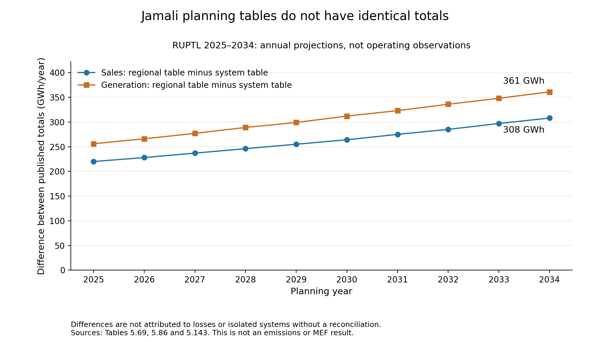

# Jamali planning-input audit

Completed **10 November 2026**. This is a targeted source and compatibility audit, not an MEF estimate or an exhaustive search for public data. It builds on the [long-run methods review](LONG_RUN_REVIEW.md) while retaining the separate operating-data requirements for short-run estimation.

## Report-ready findings

Before estimating how geothermal changes emissions, the research needs a consistent picture of the electricity system being modelled. This audit compared Jamali planning tables in PLN's RUPTL 2025–2034 and inspected the newly retrieved PLN Statistics 2024 publication. The working boundary remains the interconnected Jawa–Madura–Bali system, rather than every electricity system located in those islands.

The planning tables do not all report identical totals. For 2025, projected regional electricity sales are 226,327 GWh, compared with 226,107 GWh in the interconnected-system power balance: a difference of 220 GWh. By 2034, this difference reaches 308 GWh. These gaps are about 0.09–0.10% of regional sales. They are small relative to total electricity sales, but demonstrate why tables should not be combined without checking their coverage. The audit quantified the differences; it did not establish their complete cause (PLN, 2025a, Tables 5.69, 5.86–5.87).

The RUPTL also explicitly includes isolated-system solar in regional additions and includes electricity imported from Sumatera within some hydro and geothermal generation entries. Those entries therefore cannot automatically be treated as generation from plants connected locally to the main Jamali grid (PLN, 2025a, §V.5.7.3.2, item 5; Tables 5.143–5.144, footnotes).

PLN Statistics 2024 adds historical annual information on electricity balances, fuel consumption and fuel prices. This is useful context, but annual reporting-unit totals are not a ready-made record of how individual generators respond hour by hour. The audited sources do not yet provide a verified, compatible package of generator operating characteristics, future investment costs, time-varying demand and renewable output, and electricity exchanges. The next step is to construct a source-backed fleet inventory and map its generators to the electrical boundary, not to train an ML model or calculate an MEF from mismatched annual totals (PLN, 2025b, definitions and Tables 1–2, 24–26).

## 1. Sources and evidence depth

| ID | Material inspected | Evidence boundary |
|---|---|---|
| J1 | Existing full RUPTL 2025–2034 PDF; targeted planning and boundary sections | Published projections and planning assumptions, not observed dispatch. Reuses the L6 snapshot; no new RUPTL download |
| J2 | Official PLN Statistics 2024 PDF, 106 pages, retrieved through a working official download route | Full file acquired; selected definitions, organisational notes and annual tables inspected. Not every number was extracted or validated |
| J3a/J3b | Existing extracted RUPTL sales and generation files | Cross-checks against J1, not independent evidence |

PLN Statistics 2024 covers calendar-year 2024; its preface is dated June 2025. This is distinct from the RUPTL's partial/unaudited historical 2024 generation coverage. The earlier failed statistics URL remains in the access history; a working alternative does not prove the two URLs serve identical bytes. Exact URLs, hashes, page coverage and access failures are in [the audit manifest](planning_input_audit_manifest.json) and [references](REFERENCES.md#targeted-jamali-input-audit).

## 2. Boundary and demand checks

**Working boundary:** interconnected Jamali, with exchanges and embedded/captive generation included or excluded only through explicit, documented rules. This is a modelling scope decision, not a claim that every source already follows it.

| Quantity (GWh/year) | 2025 | 2034 | Source |
|---|---:|---:|---|
| Regional electricity sales | 226,327 | 324,445 | Table 5.69, PDF p.324 / printed V-88 |
| Interconnected-system electricity sales | 226,107 | 324,137 | Tables 5.86–5.87, PDF pp.351, 355 |
| Regional minus system sales | 220 | 308 | Reproduced subtraction |
| Published regional generation total | 251,401 | 369,420 | Tables 5.143–5.144, continuation PDF pp.484–485 |
| System power-balance production | 251,145 | 369,059 | Tables 5.86–5.87 |
| Regional minus system generation/production | 256 | 361 | Reproduced subtraction |

All ten planning years were checked. RE Base and ARED have equal system sales, production and net peak values in the inspected tables, and equal published regional generation totals. One source difference remains: 2031 gross peak is 45,076 MW in RE Base and 45,075 MW in ARED. It is retained rather than silently corrected.

Important interpretation checks:

- **Sales are not system load.** Billed electricity, generated electricity and a peak in MW are different quantities. Annual sales and a peak cannot reveal the timing of hourly demand. Table 5.69 labels its peak *non-coincident*; it should not be substituted for a coincident system peak without justification.
- **Differences are not automatically transmission losses.** PLN's definitions distinguish plant own use, transfers, transmission losses, distribution losses and billed energy (J2, PDF pp.8–11 / printed vi–ix). No complete numerical bridge between the RUPTL tables has yet been established.
- **Isolated systems require explicit exclusion/mapping.** RUPTL §V.5.7.3.2, item 5 (PDF p.360 / V-124), explicitly includes isolated-system and rural/dedieselisation solar in Tables 5.88–5.89. Its East Java discussion also identifies 25 isolated subsystems (PDF p.918 / B-94). These observations do not prove those systems explain the full sales gap.
- **Imported energy can be embedded in technology entries.** Tables 5.143–5.144 identify Sumatera–Java hydro/geothermal imports in footnotes (PDF pp.484–485). A dash in the separate import row must not be interpreted as proof of no imported electricity. Local capacity-addition footnotes have a different coverage (PDF pp.361–362).
- **Reporting units need a crosswalk.** PLN's organisational and energy-balance tables are not automatically electrical-system boundaries (J1, PDF p.48 / I-11; J2, reporting notes and Tables 1–2). Do not add parent totals and their subordinate rows or treat a unit name containing Jamali as the entire grid.



Figure: published regional totals minus interconnected-system totals, not inferred losses, isolated-system output, emissions or MEFs. Both scenarios share these annual quantities. For scale, the regional sales gap stays near 0.1% of regional sales; the zero-based chart shows the absolute difference, not the full system's size.

## 3. What is ready, and what is still missing?

Statuses describe this bounded audit, not every dataset that might exist.

| Input group | Evidence now available | What still gates numerical modelling |
|---|---|---|
| Boundary and annual demand | System-specific projected sales/production and peaks; regional differences quantified | Complete coverage bridge; historical overlap and gross/net conventions; time-varying demand profile |
| Existing and planned fleet | RUPTL capacity/addition tables and PLN annual capacity context | Resource-level IDs, grid connection, capacity definitions, ownership/reporting crosswalk and double-count checks |
| Operating costs and emissions | J2 Table 24 annual fuel quantities, Table 25 annual fuel unit prices, Table 26 annual energy by fuel | Generator heat rates, fuel quality/emission conversion, variable costs, availability and compatible local emissions checks. Fuel units differ; prices cannot be directly compared as costs per MWh |
| Investment and retirement | Published planning additions and discussion of operating-life/PPA considerations | Candidate resource costs, future fuel-price assumptions, financing/lifetimes, feasible build limits and contract/retirement constraints. A source dash is not a verified zero; age alone is not a local retirement rule |
| Time profiles and operating limits | Annual totals and peaks provide aggregate context | Aligned load, renewable/hydro availability, outages, ramping and minimum-output information appropriate to the selected method |
| Exchanges and transmission | RUPTL interconnection plans and embedded-import footnotes | Consistent interface treatment and operating/transfer limits; flows and topology where required by spatial detail |
| Calibration and validation | Historical annual statistics can support appropriately matched aggregate checks | A compatible time-aligned operating/emissions sample for short-run estimation or operating validation; no observed future no-project outcome |
| Experiment and horizon | Short-/long-run distinction established in the methods review | Defined geothermal perturbation, allowed investment response, horizon and matched reference case before a long-run solve |

**Decision:** neither numerical pilot is cleared yet. New annual fuel information improves the inventory; it does not establish that a model would estimate the marginal response accurately. The audit supports a concrete data-preparation step, not replacement of CM or a legal conclusion.

## 4. Next bounded task and acceptance criteria

Build a **resource-level fleet inventory and boundary crosswalk**, using source-backed rows rather than totals as pseudo-plants. Each row should record plant/unit identifier, technology and fuel, location/grid, operational status, installed versus dependable capacity, commissioning/retirement evidence, reporting unit, source page/date and unresolved fields. Keep existing plants separate from planned candidates, and local generation separate from imported electricity.

Reconcile the inventory's totals to explicitly chosen source definitions, documenting excluded isolated plants and unresolved matches. Missing heat rates, availability, operating/investment costs and retirement constraints must remain marked missing, not filled with invented Indonesian values. Alongside this inventory, identify an actual time-profile sample with units, timestamps and coverage; a generic profile would be an assumption, not observed Jamali data. No institutional data requests were sent in this audit.

This task succeeds when coverage and gaps can be checked row by row. Only then decide whether an assumption-labelled engineering demonstration is useful or whether the supported deliverable remains a readiness roadmap. Do not select a more flexible ML model to bypass these gaps.

## 5. Reproduction and validation

From the repository root:

```sh
python3 -B mef_research/audit_jamali_planning_inputs.py
python3 -B mef_research/audit_review_sources.py
```

The extraction script verifies input checksums; reproduces ten regional years and twenty system scenario-years; checks the earlier sales extraction exactly; detects duplicate generation component keys; and preserves source discrepancies. Sums of earlier extracted generation components differ from published totals by at most **2 GWh**, within the existing extraction's 3 GWh tolerance. These small residuals are recorded, not confused with the much larger regional/system differences or redistributed among fuels. The tolerance is a consistency check, not independent validation of every component.

Outputs in [output/jamali_input_audit/](output/jamali_input_audit/) include the full annual comparisons, raw extracted table cells, validation results and report-ready PNG. Selected source pages and the chart were visually inspected. Earlier model outputs are unchanged. Passing these checks establishes reproducibility and evidence integrity, not causal MEF validity or predictive accuracy.
