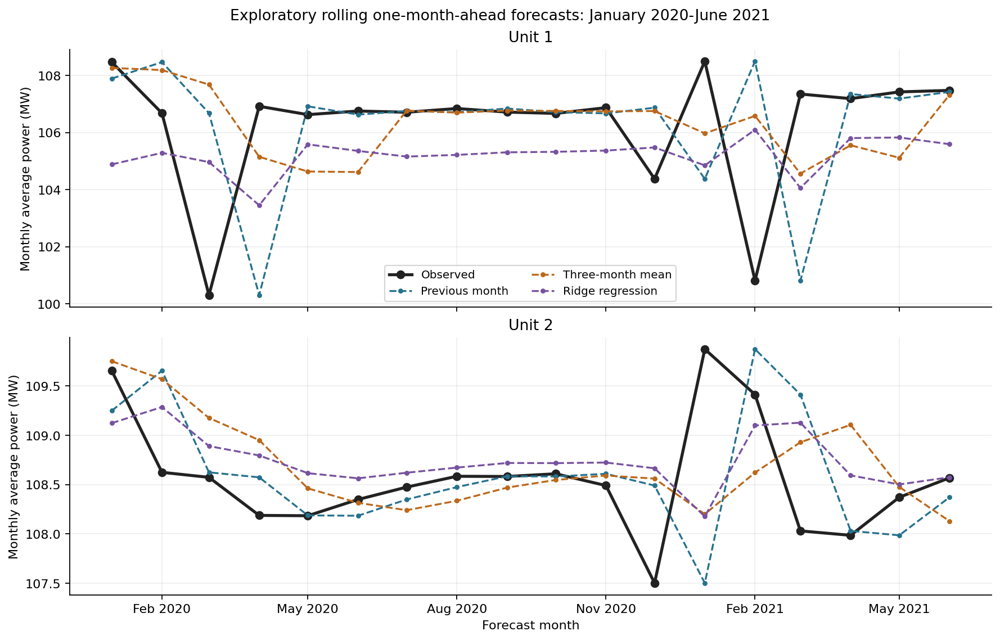
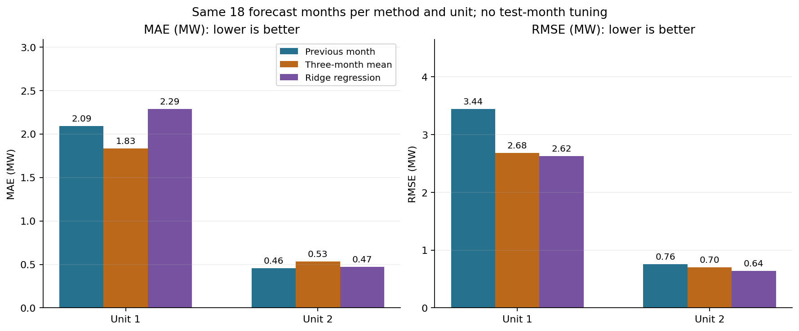
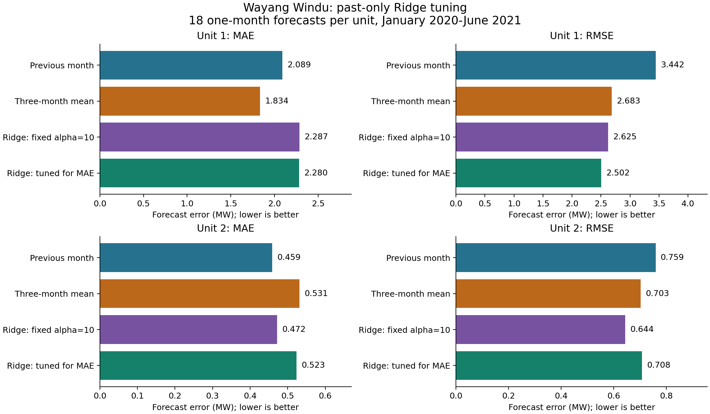

# Exploratory Monthly Plant-Output Forecasting: Wayang Windu

## Aim and Data

This experiment tested whether Ridge regression improved one-month-ahead forecasts of Wayang Windu's monthly average power compared with simple forecasting methods. Unit 1 and Unit 2 were modelled separately, using the same evaluation dates.

The dataset contained 42 months of observations for each unit, covering January 2018 to June 2021. The target was monthly average power in MW, calculated by dividing each unit's reported monthly Main Meter electricity output in MWh by the number of calendar hours in that month. This allowed months of different lengths to be compared consistently.

## Original Forecasting Methods

Three methods were initially compared:

- **Previous-month baseline:** predicted that the next month's average power would equal the latest observed month.
- **Three-month trailing average:** predicted the mean power of the latest three observed months. This provided a short-history smoothing baseline using the same three recent observations supplied to Ridge. Three months was a fixed experimental choice, not an established optimal window based on Pearson correlation.
- **Ridge regression:** used the previous three months' average power as inputs to predict the following month. Ridge penalises large coefficients to limit overfitting, although this does not guarantee accurate forecasts.

In the fitted model, the prediction was an intercept plus the weighted contributions of the three standardised lag inputs. The intercept and weights were learned from training data. Because the inputs were standardised, these weights apply to rescaled inputs rather than directly to raw MW values.

Ridge's inputs were standardised using only the training observations available at each forecast date. In the original experiment, its regularisation strength was fixed at alpha = 10 and no hyperparameter tuning was performed. A subsequent experiment tested past-only alpha tuning while preserving the original results for comparison.

## Chronological Evaluation

The initial training period covered January 2018 to December 2019. Evaluation covered January 2020 to June 2021, providing 18 one-month-ahead forecasts per unit for each method.

For example, the January 2020 forecast used observations through December 2019. After the actual January value was added to the training history, the models forecast February 2020. This process continued through June 2021.

This was an expanding-window evaluation: the models received newly observed values as time progressed. It was not a single forecast made 18 months into the future. The initial Ridge fit contained 21 supervised training examples after constructing three-month lags from the first 24 observations.

Forecast accuracy was measured using MAE, the mean absolute difference between predicted and observed power in MW, and RMSE, an error measure in MW that gives greater weight to larger mistakes. Lower values indicate better performance.

## Original Observed and Predicted Monthly Average Power

Unit 1 experienced larger changes in monthly average power during the evaluation period, while Unit 2 remained more stable. The forecasts followed recent operating levels but did not consistently anticipate abrupt changes. The two unit panels use different vertical scales, so fluctuations should be compared using the MW values rather than visual height alone. These forecast paths belong to the original fixed-alpha experiment, not the tuned model.

## Original Forecast Accuracy

| Unit | Method | MAE (MW) | RMSE (MW) |
|---|---|---:|---:|
| Unit 1 | Previous month | 2.089 | 3.442 |
| Unit 1 | Three-month trailing average | 1.834 | 2.683 |
| Unit 1 | Ridge, fixed alpha = 10 | 2.287 | 2.625 |
| Unit 2 | Previous month | 0.459 | 0.759 |
| Unit 2 | Three-month trailing average | 0.531 | 0.703 |
| Unit 2 | Ridge, fixed alpha = 10 | 0.472 | 0.644 |

The original results were mixed. Fixed-alpha Ridge achieved the lowest RMSE for both units, but it did not achieve the lowest MAE for either unit. The three-month trailing average had the lowest MAE for Unit 1, while the previous-month baseline had the lowest MAE for Unit 2. For Unit 1, Ridge's RMSE advantage over the three-month average was small: approximately 2.625 MW compared with 2.683 MW.

## Follow-up: Ridge Hyperparameter Tuning

A follow-up experiment tested whether selecting Ridge's regularisation strength from earlier observations improved forecasts. Six alpha values were compared: 0.01, 0.1, 1, 10, 100 and 1,000. Smaller alpha values apply a weaker coefficient penalty; larger values apply a stronger penalty. The candidate grid, validation windows and MAE selection objective were fixed before calculating the tuned results, although the original results had already been examined.

At each forecast month, alpha was selected separately for each unit using an inner expanding-window evaluation that included only earlier observations. Inner training began with January-December 2018. Each candidate first forecast January 2019, then incorporated the actual observation before forecasting the next month. The alpha with the lowest average inner-validation MAE was selected; exact ties favoured the larger alpha. Every inner fit recalculated its standardisation using only that fold's training data.

For the January 2020 outer forecast, tuning used the 12 historical forecast errors from January-December 2019. The selected alpha was then used to refit Ridge on the full January 2018-December 2019 history and forecast January 2020. January 2020's actual output was not used to select its own forecast settings. Once January 2020 was observed, it could be included when tuning for February 2020.

The outer evaluation dates remained January 2020-June 2021, giving the same 18 forecast months per unit. There were 12-29 inner validation months per alpha choice as the history expanded. The first inner fit had only nine supervised examples. Tuning optimised MAE, not RMSE. It added no new plant observations or operational variables, and no New Zealand data were used.

## Forecast Accuracy Including Tuned Ridge

| Unit | Method | MAE (MW) | RMSE (MW) |
|---|---|---:|---:|
| Unit 1 | Previous month | 2.089 | 3.442 |
| Unit 1 | Three-month trailing average | **1.834** | 2.683 |
| Unit 1 | Ridge, fixed alpha = 10 | 2.287 | 2.625 |
| Unit 1 | Ridge, tuned using earlier MAE | 2.280 | **2.502** |
| Unit 2 | Previous month | **0.459** | 0.759 |
| Unit 2 | Three-month trailing average | 0.531 | 0.703 |
| Unit 2 | Ridge, fixed alpha = 10 | 0.472 | **0.644** |
| Unit 2 | Ridge, tuned using earlier MAE | 0.523 | 0.708 |

Tuning produced mixed results. For Unit 1, MAE decreased slightly from 2.287 to 2.280 MW and RMSE decreased from 2.625 to 2.502 MW relative to fixed-alpha Ridge. However, the three-month trailing average still had the lowest MAE. For Unit 2, tuning increased MAE from 0.472 to 0.523 MW and RMSE from 0.644 to 0.708 MW. The previous-month baseline retained the lowest MAE, while fixed-alpha Ridge retained the lowest RMSE.

Selecting the alpha that performed best during earlier validation months did not guarantee that it would perform best in the following month. MAE and RMSE also emphasise different aspects of error, so tuning for MAE did not guarantee an RMSE improvement. These results do not support a general claim that tuning or machine learning outperformed the simpler methods.

## Limitations and Conclusion

The evaluation contained only 18 forecast months per unit, and both units belonged to the same geothermal field. The full historical period had already been examined during EDA, and the tuning follow-up reused the original evaluation dates after the original scores were known. These results are exploratory historical evaluations, not an untouched confirmatory test. Past-only tuning prevents current or future target observations from entering their own forecast selection, but does not undo the earlier research exposure to this period.

The models used past output only. They did not include maintenance schedules, steam conditions or other operational information that might help explain changes. The revised monitoring data also do not establish when observations would have become available in real time. The pronounced Unit 1 reduction in June 2019 belonged to training, not the outer evaluation period; these results do not demonstrate advance prediction of that event.

Overall, the experiment established Indonesian plant-output benchmarks and found limited, metric-dependent benefits from Ridge. Tuning modestly improved Unit 1's Ridge forecasts but worsened Unit 2's, and neither Ridge approach achieved the lowest MAE for either unit. The analysis did not establish reliable performance for other geothermal plants or validate generation assumptions through 2034. It did not determine which grid generation would be displaced or directly calculate avoided emissions. Any model choice informed by these results would require additional held-back observations for stronger confirmation.
